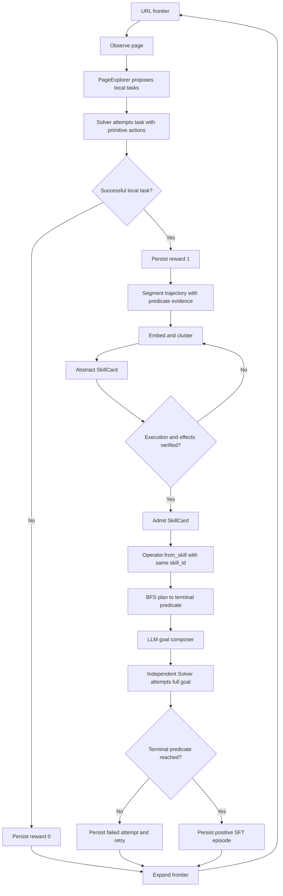

# Exploration Phase Report: Unified Skills and Operators

## 1. Purpose

Exploration has two outputs:

1. recurring successful local behavior becomes a verified, reusable `SkillCard`;
2. verified skills are composed symbolically into longer goals whose successful
   trajectories become terminally verified training data.

The implemented feedback loop is:

```text
explore pages -> solve local tasks -> discover verified SkillCards
              -> derive Operator views -> plan a verified skill chain
              -> compose one natural-language long goal
              -> independent Solver attempts the full goal
              -> retain terminally verified trajectories
```

A skill has two views under one `skill_id`:

- **execution view:** slots, action template, natural-language precondition, and
  success predicate used during skill verification;
- **planning view:** symbolic preconditions, effects, and terminal flag used by
  `OperatorGraph`.

There is no independent operator-mining path.

## 2. End-to-end dataflow



## 3. Local exploration

`WebArenaExplorer.run` maintains a URL frontier. `FrontierScorer` ranks nodes
using uncertainty and parent-branch value. For each selected page:

1. `PageExplorer` proposes grounded, page-local tasks from URL, AXTree, and
   domain context;
2. `Solver` attempts each task using only primitive browser actions;
3. every attempt is persisted;
4. only successful local attempts enter `Discovery`;
5. callback-discovered URLs, or filtered DOM links as fallback, expand the
   frontier.

Node identity preserves sorted semantic query parameters, removes fragments,
and ignores only tracking parameters configured by
`browser.ignore_query_params`. `visited` contains successfully processed node
identities (including redirect aliases), while `queued` contains only pending
or retry-reserved nodes. Successful, terminally skipped, and exhausted nodes are
released from `queued`; transient load/process failures are requeued up to the
configured limit.

Learned skills are not injected into `PageExplorer` or `Solver`. Account and
safety text is passed separately as generic `context_hints`.

## 4. Unified skill induction

### 4.1 Segmentation and symbolic evidence

`segment_trajectory` creates URL-boundary and compact action-level segments.
Each `SubTrajectory` stores:

```text
planning_preconditions = predicates(start URL, start AXTree)
planning_effects       = predicates(end URL, end AXTree) - preconditions
```

The evidence therefore comes from observations, not from an LLM-generated
operator.

### 4.2 Clustering and abstraction

The online clusterer groups segments by embedded subgoal and action signature.
At maturity, abstraction creates a parameterized `SkillCard`. A symbolic
predicate is retained in the planning view only when at least two thirds of the
cluster members support it. Effects already present as preconditions are
removed.

### 4.3 Verification and admission

The verifier grounds and executes the candidate in held-out contexts. Browser
verification additionally requires every declared planning effect to be
observable after execution.

Only a verified card enters `SkillLibrary`. The admission callback then calls:

```python
Operator.from_skill(card)
```

The resulting operator keeps `card.skill_id`. An unverified card cannot create
an operator.

## 5. Planning and goal composition

`OperatorGraph` is keyed by `skill_id`. An edge `A -> B` exists when an effect
of A satisfies a precondition of B. Forward BFS applies operators monotonically
and returns the shortest skill-ID chain reaching the configured or automatic
terminal predicate.

The chain is not an execution script. It establishes that a long goal is
supported by verified learned behavior and supplies its curriculum difficulty.

The goal composer receives:

- ordered skill IDs;
- skill names and descriptions;
- planning effects;
- terminal predicate;
- current URL and AXTree excerpt.

It returns `{instruction, skill_ids}`. The result is accepted only when the
returned IDs exactly match the ordered plan. Invalid output falls back to a
deterministic instruction assembled from the verified chain.

## 6. Independent composed-goal execution

The Solver receives only:

- the composed natural-language instruction;
- browser observation and action history;
- primitive action documentation;
- account and safety context.

It never receives SkillCard descriptions, templates, slots, hints, or tools.
The symbolic chain does not constrain its action sequence.

Success requires `reached(terminal_predicate, final_url, final_axtree)`. A
completion message alone cannot mark a composed goal successful.

Each composed goal has `max_goal_attempts` full attempts, defaulting to three.
The browser is reset to the same node before every attempt. Each attempt becomes
its own episode; retry stops after the first terminal success. Failed attempts
remain reward-0 diagnostics, while the successful trajectory—including any
recovery actions inside that attempt—is eligible for SFT.

Composed trajectories do not re-enter Discovery and do not create macro-skills.

## 7. Persistence and outputs

The root [`config.yaml`](../config.yaml) contains every supported exploration
knob grouped by run, LLM, browser, goals, tasks, skills, frontier, and
lookahead. It is loaded automatically from the project root; an alternative can
be selected with `--config`. Explicit CLI flags override YAML values, while API
keys remain in `.env`.

```bash
python run_webarena.py --dry-run
python run_webarena.py --config configs/experiment.yaml
python run_webarena.py --config config.yaml --max-nodes 50
```

Important outputs remain under the run directory:

```text
checkpoint.json       version 4 navigation/graph/cluster state
skills.json           source of truth for verified unified skills
graph.json             URL graph and real SkillCard nodes
curriculum.json        exported skill-chain curriculum
episodes/              one directory per local or composed attempt
skill_diagnostics.json abstraction and verification audit trail
```

Operators are derived from `skills.json` during resume and are not persisted as
an independent source of truth. Checkpoints older than version 4 are rejected
with an instruction to start a new run directory.

`build_sft_dataset.py` selects successful episodes, so failed retries are not
included in the generated SFT dataset.

## 8. Architectural invariants

- no verified SkillCard means no Operator;
- SkillCard and Operator always share one `skill_id`;
- planner input contains only verified skills;
- local successful trajectories are the only source of new skills;
- composed trajectories are training artifacts, not discovery input;
- Solver is independent of learned skills;
- planning is monotonic and currently has no delete effects;
- all predicates and abstractions remain domain-agnostic.
